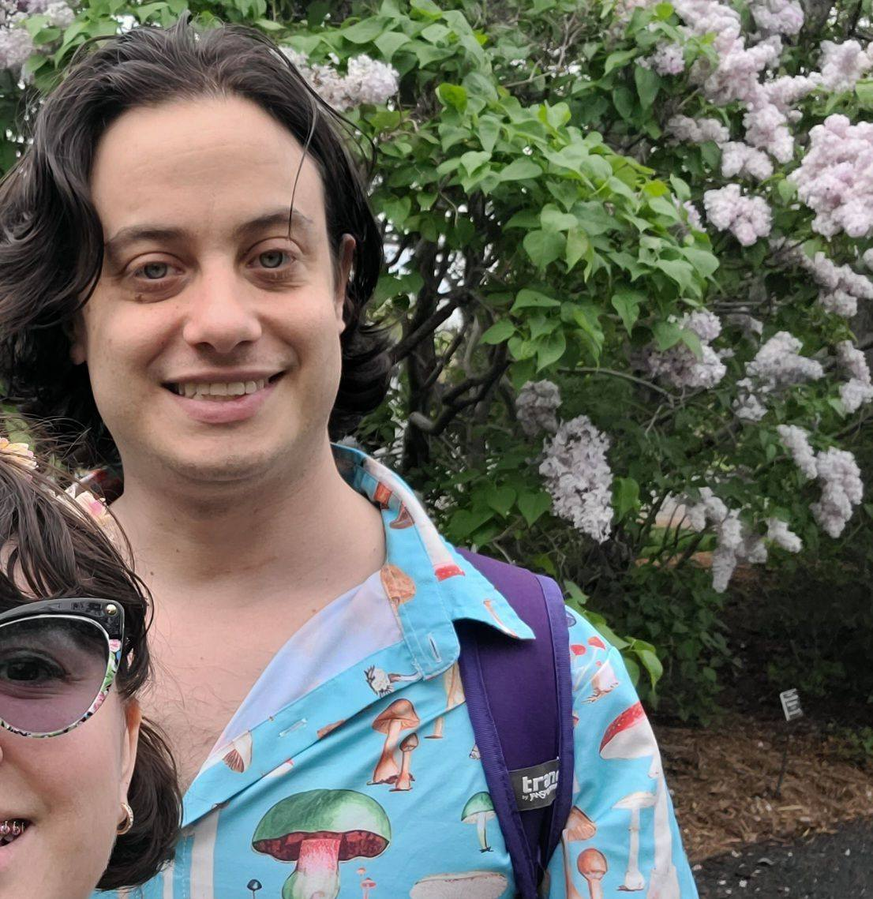
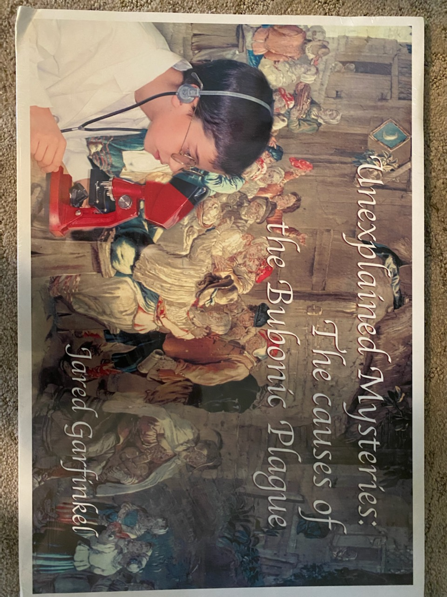
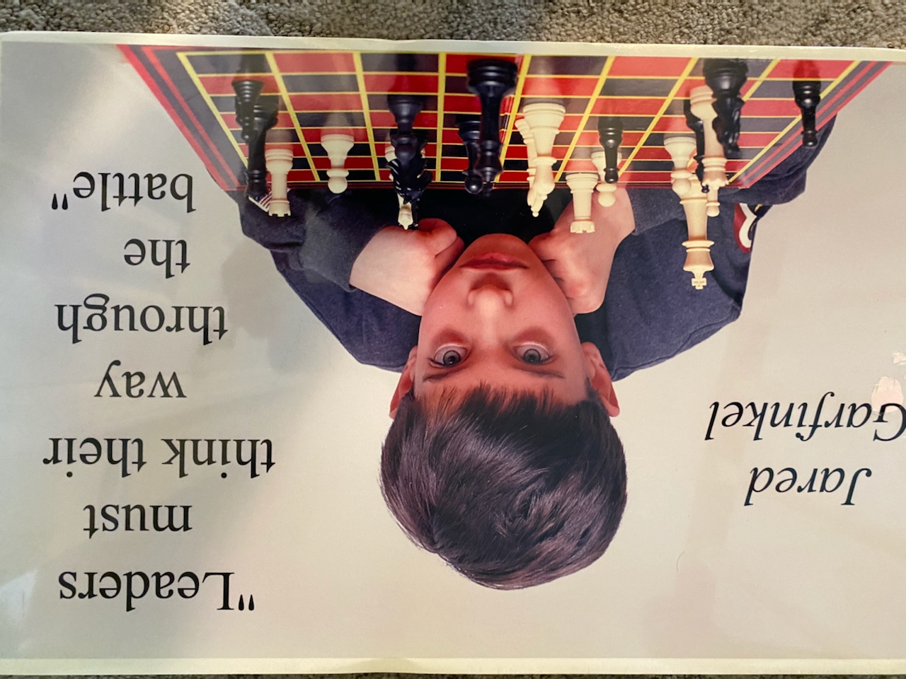
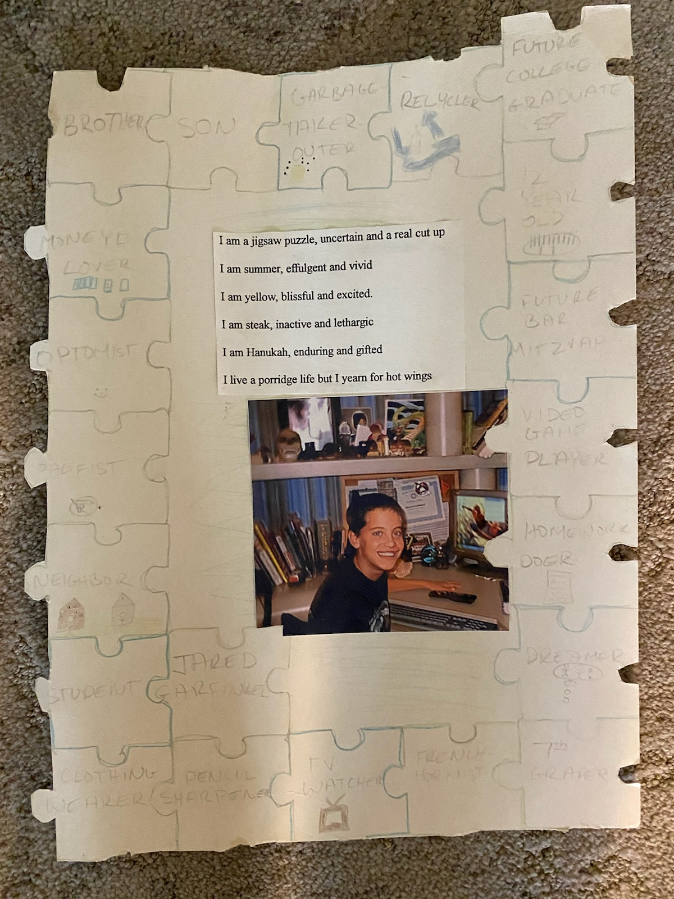

## This is Jared's awesome website

### I have wanted to be a scientist for as long as I can remember

### I used to make up quotes

### I wrote this poem a while back

***

"When issues of significant moral value can be related to safety they become widely accessible."

* Jared Garfinkel

## Bio

***

Jared Garfinkel has recently worked at the NGO ICAP as a Data Analyst where he focused on process improvement and automation for lab data dashboards. Before that he received a Master of Science (M.S.) degree in Biostatistics from Columbia University. Previously he earned a Master of Arts (M.A.) degree in Sustainability from Hofstra University, where his coursework focused on climate science and international development. He is currently seeking a data analyst role doing a public service in academia or the public sector. The work before Garfinkel is to challenge society to build the economy that cares for everyone.

***

Biostatistics, being the application of statistics to public health, bridges Garfinkel's appreciation for mathematics and data collection with his life mission to end climate change and stop racism. Throughout Garfinkel's academic and professional career, the overarching goal has been to contribute thoughtfully to these major issues. Through public health solutions, Garfinkel wants to live in a world where children are free from environmental harm and one's zip code does not predict one'slongevity and earning potential.

***

While climate change has and will continue to affect the work public health practitioners do, it was Garfinkel’s dedication to social equity that drove him back to public health. 
In a way, the piece of Garfinkel's career that bridges his talents in lab data management and data analysis support, with his skills in sustainability that he learned in his first master's degree program is the aspect of international development. In the future Garfinkel hopes to continue to contribute to the field of public health to make his larger community a better place to live.

***

You can find my CV [here](jaredgarfinkel.html)
